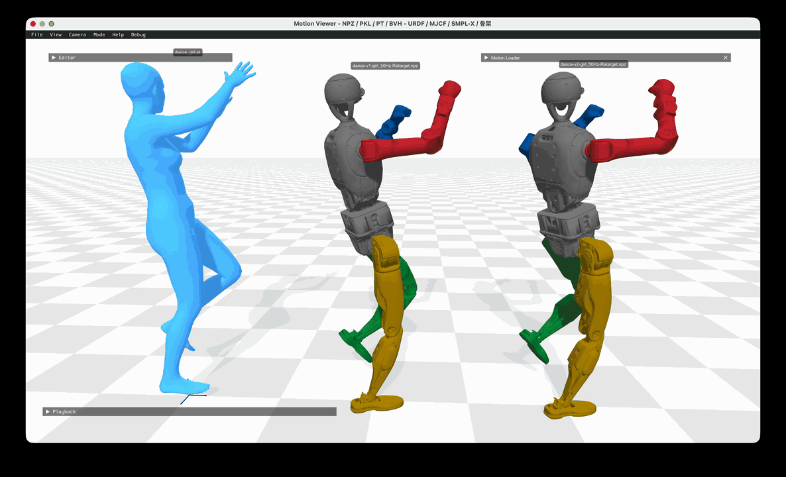

# Dex-Retarget

将人体动作转换为 **Dex 29 关节、50 Hz 的机器人运动学参考**，用于动作预览和训练数据准备。支持已适配的 BVH 骨架及 SMPL-X 人体参数（`.pt`、`.npz`、`.pkl`）。

当前版本为 **0.8.2**。版本与验证结果见 [CURRENT_VERSION.md](docs/CURRENT_VERSION.md)。

## 安装

使用 Python **3.11 或 3.12**。在项目根目录执行；以下以 Python 3.12 为例。

若交付目录中没有 `Dex-StanfordASL-frax/`，先获取 Frax：

```sh
git clone https://github.com/StanfordASL/frax.git Dex-StanfordASL-frax
git -C Dex-StanfordASL-frax checkout f5e87ab59a0b82ba43095e882c1b88c9b0dacf07
```

然后安装：

```sh
python3.12 -m venv .venv
.venv/bin/python -m pip install -e './Dex-StanfordASL-frax[ik]'
.venv/bin/python -m pip install -e '.[preview]'
.venv/bin/dex-frax --help
```

目录搬迁后重新创建虚拟环境，不复制 `.venv`。运行依赖见 [pyproject.toml](pyproject.toml)，验证环境的版本快照见 [requirements-lock.txt](requirements-lock.txt)。

以上命令适用于完整源码目录。单独安装 wheel 或源码分发包时，须另备机器人资产，并设置 `DEX_FRAX_ASSETS`。LAFAN/SOMA 另需参考几何表；SMPL-X 另需人体模型与依赖。准备方法见 [输入规范](docs/INPUTS.md)。

## 转换动作

先运行附带的 BVH 示例，输出目录必须尚不存在：

```sh
.venv/bin/dex-frax convert \
  examples/bvh/nobody/nobody.bvh \
  outputs/nobody --source mocap
```

| 模式 | 行为 |
|---|---|
| `--mode fast`（默认） | 完整 Frax 求解、导出和质量检查 |
| `--mode refine` | 自动选择腿脚初解路线，再修复问题窗口并整片复查 |

`refine` 检查原始 Frax 轨迹的下肢碰撞。碰撞少时保留原始腿脚，仅修对应窗口；碰撞多或窗口修复未通过检查时，使用整片腿脚求解。实际路线记录在 `motion.json` 的 `frax.body_priority.lower_routing`。

```sh
.venv/bin/dex-frax convert input.bvh outputs/refined \
  --source mocap --mode refine --repair-budget 240
```

`--repair-budget` 限制局部修复时间；预算结束时保留已采用的改进及待处理记录。单文件 `--budget` 限制包含准备、初解和检查在内的总时间，默认 86400 秒。精修续跑见 [流程说明](docs/PIPELINE.md#检查点与续跑)。

BVH 来源使用 `lafan`、`soma` 或 `mocap`；`mocap` 需要已适配的骨架，不能直接接收任意 BVH。BVH 默认厘米、`absolute` 位置通道，可通过 `--bvh-units` 和 `--bvh-translations` 指定。

`examples/` 提供人体输入、两版机器人动作和逐帧对照：

| 路径 | 内容 |
|---|---|
| `examples/bvh/nobody/nobody.bvh` | 2085 帧、90 fps 的 mocap 骨架 BVH（厘米、Y-up），配合 `--source mocap` |
| `examples/bvh/nobody/` | `nobody_v1-50Hz-Retarget.npz`、`nobody_v2-50Hz-Retarget.npz`，各 1158 帧；`nobody_逐帧对照.csv` |
| `examples/smplx/gbtc/gbtc.pt` | 420 帧、30 fps 的 GVHMR SMPL-X 参数缓存，需另备人体模型与依赖 |
| `examples/smplx/gbtc/` | `gbtc_v1-50Hz-Retarget.npz`、`gbtc_v2-50Hz-Retarget.npz`，各 699 帧；`gbtc_逐帧对照.csv` |

`v1` / `v2` 对应 `--foot-contact v1` / `v2`（默认 v2，见下文）。两版 NPZ 均为 50 Hz，与转换生成的 `motion.npz` 同格式：`root_pos`、`root_rot`（XYZW）、`dof_pos`、`joint_names`、`quat_order`、`model_sha256`、`robot`。逐帧 CSV 对比两版的关节最大差异和根平移差异，以及左右脚的支撑相位、目标与实际 roll、sole 三轴角、鞋底与外缘最低点。



同一段人体动作与两版 50 Hz 参考动作在一个查看器里同步回放：初始状态左为人体骨架，中为 `v1`，右为 `v2`。回放是运动学示意，不含动力学。

`preview` 只接受转换结果中的 `motion.pkl`，不能直接播放这些参考 NPZ；它们用于数值对照，不代表当前 `accepted` 结论。

SMPL-X 输入先按 [输入规范](docs/INPUTS.md#smpl-x) 配置 `SMPLX_PYTHON` 和 `SMPLX_MODEL_DIR`，再运行：

```sh
.venv/bin/dex-frax check-input examples/smplx/gbtc/gbtc.pt \
  --smplx-python "$SMPLX_PYTHON" --input-fps 30
.venv/bin/dex-frax convert examples/smplx/gbtc/gbtc.pt outputs/gbtc \
  --source smplx --body-models "$SMPLX_MODEL_DIR" \
  --smplx-python "$SMPLX_PYTHON" --input-fps 30 --grounding contact
```

`--input-fps` 应填真实源帧率，`.pt` 后缀本身不代表 30 Hz。示例中的 `.pt` 是人体输入，已有机器人 `.npz` / `.pkl` 不能作为 SMPL-X 参数输入。

### 足部接触规则

单文件转换和 BVH 批处理默认使用 v2.0。单端支撑要求另一端持续抬起，足姿修正以约 0.1 秒过渡。SMPL-X 鞋底四区域的几何用于调节支撑侧倾，BVH 使用保守的侧倾目标。

复算 v1.0 动作时加 `--foot-contact v1`。续跑时使用与原任务相同的足部接触规则。

## 查看与使用结果

输出根目录的 `selection.json` 记录结果选择，动作及检查报告位于 `frax/`；实际模式查看 `profile` 字段。

| 结果 | 含义 |
|---|---|
| `accepted` | 通过当前配置的运动学质量检查，生成 `training.npz` |
| `review` | 已生成完整动作，但仍有未通过项；查看 `frax/quality.json` 的 `flags` |
| `failed` / `input_error` / 中断或超时 | 转换未完成；查看执行记录和日志 |

完整结果包含 `motion.pkl`、`motion.npz`、`quality.json`、`identity.json` 和 `run.json`。预览动作使用米、弧度、根四元数 **XYZW**；训练导出的根四元数为 **WXYZ**，格式为 `root_joint_lossless_v1`，读取方式见 [输出格式](docs/INPUTS.md#输出格式)。

```sh
.venv/bin/dex-frax preview outputs/nobody/frax/motion.pkl \
  --output outputs/nobody/preview.mp4
.venv/bin/dex-frax explain outputs/nobody
```

`preview` 生成 MP4、GIF 和关键帧；`explain` 只读解释已有报告。播放成功或执行状态为 `complete`，均不代表质量通过。下游训练入口读取 `accepted.json` 的 `motions`，其中路径相对于输出根目录。

## 帧率与时间对齐

机器人输出固定 **50 Hz**，第 `i` 帧的播放时间是 `i / 50` 秒，帧号从 0 开始。

默认保持源动作时间尺度。仅 `refine --allow-local-slowdown` 允许将骨盆运动过快的片段放慢，**这会延长动作时长，并改变其与原视频或音乐的同步关系**。该选项不默认开启，续跑时须保持一致。

启用后，`source_time_s[i]` 表示输出第 `i` 帧对应的原人体时刻；它可以非均匀，不能当作机器人播放时钟。人体对照应按此映射插值，详见 [时间映射](docs/PIPELINE.md#帧率与时间映射)。

## 批量转换

批处理支持 BVH。按 [批处理说明](docs/BATCH.md) 生成带输入哈希的清单，然后运行：

```sh
.venv/bin/dex-frax batch manifest.json outputs/batch --budget 604800
```

默认 `fast`，使用可用 CPU 并按内存准入控制并发。批次总预算默认 1800 秒，磁盘默认预留 80 GiB；请按任务规模设置 `--budget`、`--workers` 和 `--disk-reserve-gib`。停止与续跑方法见批处理文档。

## 检查范围

质量检查覆盖配置中的限位、限速、自碰撞、地面、支撑、抖动及姿态指标。碰撞基于声明的凸几何与帧间有限采样；同侧脚—小腿在踝 pitch、roll 均处于模型限位内时按既定规则排除，跨腿和双脚检查保留。

`accepted` 的具体范围以 `quality.json` 为准。腿形、前臂轴向和根位置等部分相似度默认仅记录指标，未设硬门槛；本项目输出尚不构成动力学平衡、控制器跟踪或真机验证结果。

## 文档

- [输入、模型与输出格式](docs/INPUTS.md)
- [转换流程与验收标准](docs/PIPELINE.md)
- [批处理、资源与续跑](docs/BATCH.md)
- [修复与回归规则](docs/SAFETY_REPAIR_RULES.md)
- [版本与验证记录](docs/CURRENT_VERSION.md)
- [第三方来源与许可](THIRD_PARTY.md)
