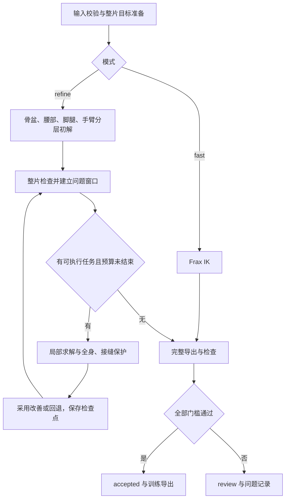

# 转换流程与验收

本文说明当前 Dex 29 关节转换流程。命令示例见 [README](../README.md)，输入和文件格式见 [INPUTS.md](INPUTS.md)。

## 两种模式

两种模式共用输入校验、源适配、整片标定、完整动作导出和质量检查。

| 模式 | 求解流程 |
|---|---|
| `fast`（默认） | Frax IK → 完整导出 → 独立检查 |
| `refine` | 分层初解 → 整片检查 → 问题窗口修复 → 最终独立整片检查 |

`fast` 使用本项目的 Dex 模型、目标和约束；不会自动升级为精修。`refine` 的初解顺序如下：

1. 生成原始 Frax 轨迹，确定骨盆水平参考；根朝向采用源目标。
2. 拟合腰部，在限位与限速范围内检查、调整腰部自身几何。
3. 检查原始 Frax 下肢的碰撞，包含原生帧及帧间采样。少量浅碰撞先只修相关窗口，其余情况沿用整片腿脚联合求解。两条路线都固定骨盆 XY、根朝向、腰部和手臂，允许调整骨盆 Z 与双腿 12 轴。
4. 固定上游姿态和脚腿，求解双臂共 14 个关节，包含所属碰撞约束。

局部路线最多处理 4 个窗口。下肢碰撞涉及的输出帧累计不超过 0.8 秒，单段连续涉及帧不超过 0.4 秒，最深穿透不超过 6 mm。这些数值用于选择求解路线，最终验收使用下文的门槛。局部候选须清除窗口核心的下肢碰撞，并保护接缝、鞋底高度、支撑锚点和时序。任一窗口未通过时，从同一原始 Frax 轨迹进入整片腿脚求解。所选路线、原生与帧间计数、候选原因记录在 `motion.json` 的 `frax.body_priority.lower_routing`。

每个阶段使用同一份已标定目标。Frax 的弹性不等式可能存在松弛，因此初解完成仍须检查实际输出。



## 帧率与时间映射

机器人输出固定 50 Hz，零基第 `i` 帧的播放时间为 `i / 50` 秒。相邻帧的输出时间间隔固定为 0.02 秒。源帧率由输入元数据或显式参数提供，不按文件后缀推断。

默认不改变时间尺度。SMPL-X 准备阶段使用不超出源末采样时刻的 50 Hz 网格，尾部与源末采样点的差小于一个输出帧。统计首尾采样点跨度时使用 `(N - 1) / fps`；`N / fps` 则按每帧占一个播放周期计算时长，二者不要混用。

显式启用 `--allow-local-slowdown` 后，仅 `refine` 会在目标标定完成后、初解之前延长骨盆运动过快的区间。内部速度目标取现有根平移与角速度门槛的 97.5%；输出仍为 50 Hz，**动作总时长可能增加，与原视频或音乐会产生累计时间差**。

| 字段 | 含义 |
|---|---|
| `output_time_s[i]` | 机器人第 `i` 帧的播放时间，固定为 `i / 50` |
| `source_time_s[i]` | 该帧对应的原人体时间，单位秒；减速时相邻间隔可小于 0.02 秒 |
| `source_frame_float[i]` | 原人体零基浮点帧号，等于 `source_time_s[i] × source_fps` |
| `source_fps` | 原人体帧率 |

这些字段保存在 `motion.time_map.npz`；动作 NPZ/PKL 和通过后的训练导出也保留源时间映射。人体对照须按映射时间插值。没有启用局部减速的结果可能不含映射字段。

减速只重新采样已准备的目标，不重新估计尺度、地面或接触标定。旋转使用 SLERP，连续量插值，离散接触与锚点保持相位归属。末尾补齐不足一个输出周期的余量时保持末姿。重采样后重新执行 IK 与质量检查，旧机器人轨迹的插值只可作种子。

## 问题窗口修复

安全相关任务包括腿部碰撞、足部支撑、帧间穿地、抖动、可信身体接触和手臂碰撞，按类别轮转。共同约束的安全任务可以在重叠窗口求解；姿态任务须等待重叠的前序问题解决或允许执行。候选用尽不等于问题通过。

| 问题 | 处理方式 |
|---|---|
| 足部支撑、腿部碰撞、帧间穿地 | 共用窗口几何拟合，开放骨盆 Z 与相关腿轴，保护骨盆 XY、根朝向、腰部和手臂 |
| 手—腿碰撞 | 先尝试相关手臂让位，必要时开放涉及的腿轴与骨盆 Z，复用窗口求解内核 |
| 肩臂碰撞 | 在固定参考下逐档开放肩臂关节，保留连续几何起点及分支搜索 |
| 腰部、上肢姿态 | 依据源方向拟合，受安全与上游姿态保护 |
| 抖动 | 按异常关节开放相关肢体，以当前动作最小改动与时序约束修复 |
| 可信身体接触 | 使用接触求解器；低置信度提示不作为硬支撑 |

腿部档位为相对固定参考的 ±5°、±10°；手—腿协作的肩部档位为 ±10°、±20°，肩臂避碰另保留 ±30° 档。偏移不能通过换种子或续跑累计重置。源姿态相似度与连续性参与优化，最终采用仍检查完整模型。

碰撞窗口优先保留完整连续片段。一般姿态窗口核心为 101 帧、两侧先各 20 帧上下文，可扩至各 50、100 帧；帧间地面窗口总长不超过 31 帧。窗口边界仅在相应安全检查已通过时冻结，允许修改的边界同时检查外侧接缝。

单候选使用 60 秒协作时间片；底层调用尚未返回时仍受外层总时限保护。未完成尝试可保存数值点续解，上下文变化则丢弃旧数值进度。同一未变上下文不重复已完成尝试。预算或候选耗尽后保留 `review` 和剩余问题。

### 候选采用与最终复查

候选必须改善目标问题，并通过关节范围、速度、全身逐对碰撞、地面、支撑、姿态保护和接缝检查。逐关节抖动集合也不得新增，不能以异常转移或仅减少总计数代替改善。未通过的草稿回退，不作为输出发布。

初始 Frax 对前后帧 8 等分测距，每对选当前最差采样建立约束并迭代重选；局部碰撞 QP 保留近碰撞对的全部 8 等分约束。内部优化余量与最终容差分别记录：例如足部支撑非恢复搜索采用 0.99 mm 内部半径，恢复目标为 0.8 mm，最终仍按 1 mm 三维误差范数检查。

局部检查复用未变区间的测量，P95、持续段及时序指标从完整数组重新汇总。精修结束后对实际 float32 输出做无缓存的整片审计，并与增量结果逐项比较；不一致则失败，不生成训练导出。

## 验收指标

| 类别 | 当前要求或口径 |
|---|---|
| 动作长度 | 训练质量检查至少 33 个输出帧；输入结构校验的 3 帧下限仅保证可处理 |
| 关节 | 模型及有效解剖范围、模型关节限速；速度从输出相邻帧重新计算 |
| 自碰撞 | 声明凸几何、原生帧与 8 等分帧间采样，使用报告记录的穿透容差 |
| 地面与足部支撑 | 穿地容差 1 mm；可信足部接触锚点三维误差不超过 1 mm |
| 其他身体支撑 | 接触阶段与来源几何的组合置信度至少 0.8，按接触类型检查高度及位置 |
| 根运动 | 平移速度 8 m/s、角速度 8 rad/s；指定根朝向保持误差最大 5° |
| 躯干 | up 方向误差最大 45°，完整方向误差 P95 为 35° |
| 上肢方向 | 上臂、前臂方向误差 P95 各 20°；手心两轴 P95 各 25° |
| 持续姿态异常 | 臂形 20°、手心 25°、肘窝方向 40°，50 Hz 下至少连续 5 帧 |
| 抖动 | 与源部位变化对照，检查快速反复换向和孤立速度脉冲；不作为硬件加速度或 jerk 认证 |

具体值以 `quality_pose.json`、`adaptive_policy.json` 和输出报告为准。上臂方向指肩至肘，前臂方向指肘至腕；肘窝、手心及前臂横向参考另行记录。方向误差是人体与机器人对应方向的夹角，不等于单关节转角。

腿部方向、前臂轴向、根 XY 和根 Z 的相似度默认记录但不设硬门槛，对应配置为 `leg_direction_p95_deg`、`forearm_width_p95_deg`、`root_xy_max_m`、`root_z_max_m`，默认 `null`。指定根朝向的误差检查目标保持与导出一致性；肘屈伸目标误差是拟合诊断。

初始 QP 非收敛记录在 `initial_solver_history`，仍会阻止训练导出；输出残差另列在 `final_residual_flags`。执行完成、求解器报告和最终质量状态分别记录。

## 碰撞覆盖

检查全身非相邻声明几何、完整双脚及跨腿脚—小腿。实际碰撞对数、集合指纹、排除项、最坏帧和帧间位置记录在 `full_self_collision`，不使用固定总对数代替当前模型记录。

装配规则排除同体、焊接体、直接父子连接件，以及明确指定的骨盆与腰部嵌套云台壳体。**同侧脚—小腿在该侧踝 pitch、roll 同时位于 XML 限位内时排除**；当前 pitch 为 [-68°, +30°]、roll 为 [-30°, +30°]，端点数值容差为 1e-7 rad。越界不获得此排除；双脚和跨腿碰撞保留。

排除属于模型规则，不代表实测间隙。碰撞专用几何不改原运动学、惯量和地面支撑模型。有限采样通过只说明所用模型与采样范围内满足检查。

## 检查点与续跑

```sh
.venv/bin/dex-frax convert input.bvh outputs/refined-next --source mocap \
  --mode refine --continue-from outputs/refined --repair-budget 240
```

`--continue-from` 写入新目录，校验输入、代码、依赖、资产、转换参数及产物哈希。来自同版本精修检查点时不重跑初解；来自同版本完整 `fast` 结果时复用原始 Frax 轨迹，再执行精修分层初解。改变精修时间预算不改变固定参考，局部检查缓存不跨进程信任。

仅局部修复实现升级时可用 `--recheck-from` 重新审计、保留动作与参考并重建队列。输入、模型、依赖、上游 Frax、验收配置与审计实现仍须一致。初解、运动学或初始几何约束改变时必须另建目录重算。身份不匹配或检查点不完整时拒绝复用。

主要精修记录：`motion.initial.npz` 为初解，`motion.raw_frax.npz` 为新跑精修时的原始 Frax 轨迹，`frax_baseline/` 为队列开始前的基线，`avoidance_reference.npy` 为避碰参考，`repair.json` 记录候选，`refine_state.json` 记录续跑状态。合法腰部纠偏整笔采用后可更新尚未锁定的对应参考区间，碰撞修复本身不能重置参考。

## 比较与适用范围

比较新旧结果须统一输入、模型、源适配、时间映射及 `audit_contract.fingerprint`。不同审计覆盖下的通过率不能直接合并。编译、初解、修复与审计耗时分别记录，短窗耗时不代替完整转换耗时。

当前执行模型为 Dex 29 关节。其他机器人需要重新适配关节语义、运动学、范围、速度、碰撞与支撑面；新 BVH 需要验证骨架、单位和坐标。复杂地形、动力学跟踪与真机表现不属于当前验证范围。
