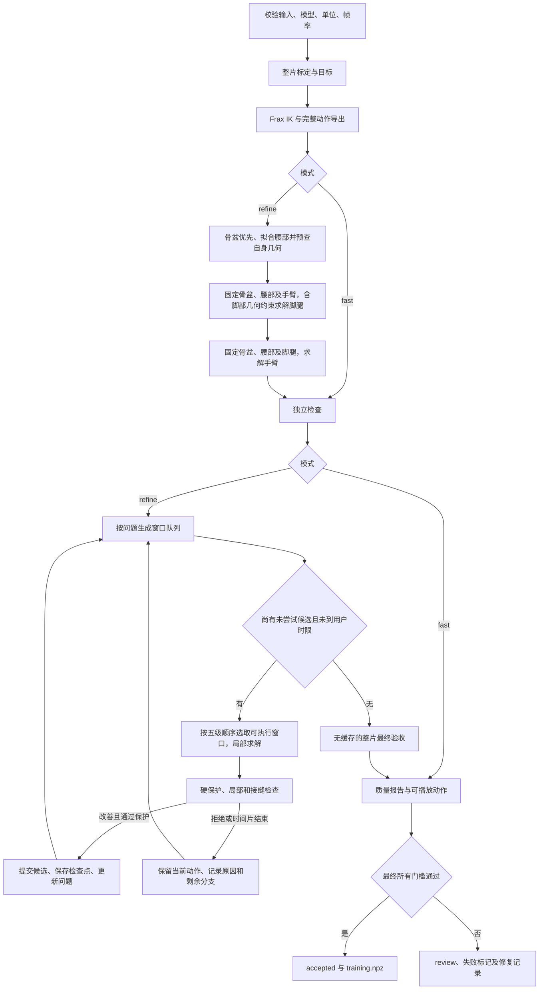
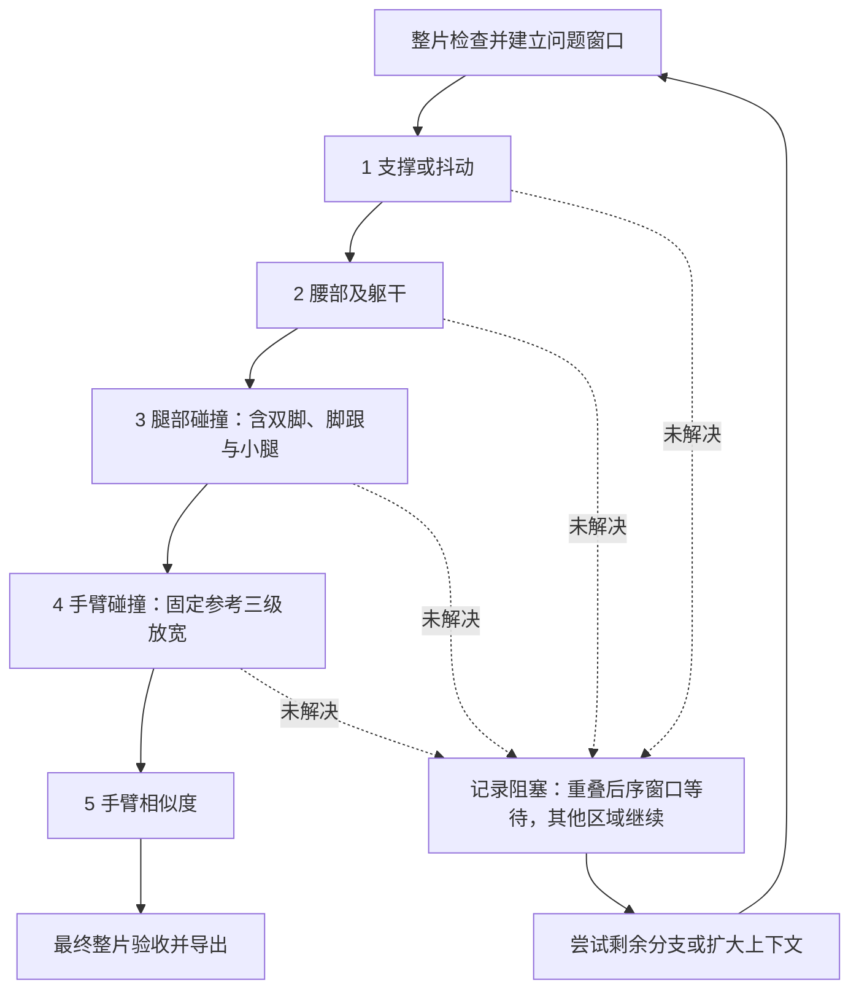

# Dex-Retarget：可解释的转换流程

## 两种模式

- **fast（默认）**：输入校验 → 源适配、整片标定和目标构造 → Frax IK → 完整 `motion.pkl` / `motion.npz` → 独立质量报告。只求解一次，不追加 V8 或局部修复。检查不修改轨迹；待审也有可播放输出。
- **refine**：同一套输入处理与 Frax 初解 → 骨盆参考、限位限速且预查腰部自身几何、固定躯干先解脚腿、固定脚腿再解手臂 → 整片检查 → 建立问题窗口队列 → 按问题修复 → 局部及接缝复查 → 采用更好的候选并更新问题 → 最终独立整片验收。

公开入口只有这两种；旧 `auto/frax/v8/hybrid` 模式及 `two-stage` 选项已移除。V8 的函数作为局部修复能力保留。代码中 `hybrid_cpu_v1` 是接触算法名称，不是转换模式。

`fast` 的纯 Frax 是 **Dex 适配版本**：上游 [StanfordASL/frax](https://github.com/StanfordASL/frax) 提供 IK，本项目提供 Dex 目标、模型、输入适配与导出。官方 G1 示例的模型/任务不同，不能声称机器人输出数值相同。`fast` 不执行旧版膝部偏好、接触缓变、躯干/手臂后处理；它也不以跳过质量报告换速度。

## 可选局部减速

仅在明确指定 `--allow-local-slowdown` 时，精修在整片目标标定之后、求解之前处理源骨盆过快的区间。各区间时长只增加、不减少，目标速度取现有根角速度/平移门槛的97.5%留出数值余量；保持固定50Hz输出。源姿态按单调原始时间映射读取，旋转用SLERP，方向归一化；原始比例、地面、身体模型及接触标定不重算，离散接触相位和锚点不跨切换混合。

`motion.time_map.npz` 保存输出时间、原输入秒数及零基浮点帧号。NPZ/PKL和通过后训练导出也保留此映射；比较人体时用映射时间，不按变化后的输出帧号直接对应。末尾不足一输出帧的余量保持末姿，不丢最后一帧。此选项不能清除碰撞或姿态失败标记；这些仍须正常修复与验收。

## 精修如何持续，又不拖慢简单动作

精修初解按 **骨盆 → 腰部 → 脚腿 → 手臂** 组织。先在原始 Frax 的固定水平轨迹和源朝向下，以声明脚部碰撞、地面和支撑约束联合选择腿部与骨盆高度；仅 Z 可补偿，XY 不参与搜索。支撑的低成本修复被碰撞保护拒绝后，可用固定参考5°/10°的脚腿联合约束候选，支撑行不可松弛。局部脚腿、支撑及穿地修复遵守相同边界；高度变化整体传递到上身，不改变腰姿或上肢关节。脚腿求解时固定骨盆、腰部和手臂，并在 Frax QP 内使用与独立审计一致的脚部凸几何及位移雅可比约束；CPU 回调拥有独立 FK 状态，原始 fast 不启用。它约束同侧外部脚—小腿及脚对其他腿/身体的声明碰撞对；Frax 不等式仍可能松弛，因此初解不作为无碰撞证书。新初解可相对旧版改变超过10°，在初解结束后才固定5°/10°修复参考，不对已有修复结果重复重设参考。手臂求解时固定骨盆、腰部及全部脚腿关节，并核对固定值完全不变。腰部拟合同时检查腰部自身碰撞对及8等分帧间几何；单轴限位内的组合姿态若相交，先在限速范围内调整腰姿，再固定它，依次求解脚腿与手臂。无法清除的腰部几何残差仍待审，不当成已安全的参考，也不让肩臂代偿。`body_geometry_preflight` 记录调整帧和未解决帧。

输入只标定一次；窗口直接切片同一套目标。先全片检查，无问题就结束。臂形等问题段使用固定网格：核心101帧（50Hz约2秒），两侧先各20帧上下文，当前上下文候选用尽后扩大至50、100帧；整片比例和接触标定不重算。相邻速度和帧间几何仍复查接缝。碰撞段优先保持完整连续片段，避免网格切口冻结正在穿透的帧；帧间地面修复使用11帧核心、5至10帧上下文，始终不超过该求解器支持的31帧。

每个待处理窗口轮流尝试候选，不再整条共用“最多6窗、120秒”。每个候选每轮60秒协作时间片；若某条底层调用尚未返回，外层工作进程总时限仍是最后保护。三级避碰是分别排队的尝试，不会因为别处还有碰撞而在已经清除的本窗反复升级。

- 严格依赖：五级顺序为支撑/抖动、腰部、腿部碰撞、手臂碰撞、手臂相似度。骨盆优先初解保留限位、限速腰姿的逐帧参考残差；腰部超出既有20°纠偏触发包络或仍有躯干自身碰撞时，重叠的腿部/手臂任务等待。候选用尽不等于前序问题消失，不能据此解锁后序窗口；其他不受影响区域可以继续。20°触发包络不替代最终躯干验收。
- 肩臂避碰：腰部原本正确时固定初始 Frax 参考；腰部确需修复时固定“人体腰姿引导＋手臂衔接、尚未避碰”的参考，J1–J3联合依次放宽±10°、±20°、±30°；每档先尝试覆盖碰撞片段的连续肩臂偏移起点，再经严格窗口求解；失败继续直接求解、非线性肩部分支和连续轨迹分支。已经清除的窗口退出碰撞队列，仍有相似度问题则进入对应队列。
- 手臂相似度：局部求解仅约束该侧手臂能够影响的碰撞对，重叠的腰/腿问题先解决；非重叠区域未动的碰撞不阻止它求解；采用候选仍逐对检查全身，不允许新增或加深碰撞。臂形误差超过最终20°门槛两倍的窗口优先尝试分支，其余先做局部拟合；这是搜索顺序，不是新的验收条件。未通过继续当前分支、原始Frax分支，以及从安全轨迹向分支提示拟合的候选；分支提示本身不直接发布。小幅改善不等于通过。
- 躯干：人体腰部参考引导、固定腰部后仅拟合手臂，以及引导后连同避碰一起检查的组合候选。中间可能碰撞的腰部草稿不提交，只验收整个组合。
- 腿部碰撞：腿与腿、腿与躯干、双脚之间、脚跟/脚尖/脚板与小腿单独排队，12个腿部关节联合参与固定参考的5°/10°候选，所有轴使用同一档位，固定根的水平位置与朝向、腰及手臂关节，仅开放根高度补偿；左右腿/双脚互撞偏好摆动腿J2/J3，J1/J4配合；同侧脚—小腿碰撞偏好J5/J6，髋膝补偿。主力通过逐帧软权重表达，支撑腿仍可参与；保持原相位、pivot/anchor与目标足姿，不把踮脚目标压平。源大腿/小腿方向作为软目标，记录候选前后的方向误差；没有所属腿部碰撞改善却使腿形RMS变差的候选被拒绝。为安全采用的腿形代价单独记录，不另加任意腿部角度硬门槛；足部支撑、地面、速度和全身逐对碰撞保护全部保留。手臂碰腿的主问题仍由肩臂路径处理，但腿部求解器也包含腿能够影响的手—腿碰撞对，防止挪腿时碰到原本安全的手。对于已存在的手—腿穿透，腿部候选只能保持或减轻，不能加深；腿部自身碰撞仍须消除。允许更宽起点的候选也必须经过同样的最终硬检查。腿部弹性恢复将支撑行与几何恢复松弛分开：支撑始终是QP硬行，在原支撑容差内留数值余量；同时提高内部QP迭代上限，以处理新增密集脚部几何；60秒时间片、数值进度续解和最终保护保持不变，不把迭代未完成误当成几何无解。不能由腿或臂运动影响的躯干碰撞明确待审，不投入肩臂搜索。
- 支撑/身体/帧间地面：对应局部求解器。可信身体接触残差进入路由；低置信度提示保留原处理，不凭提示锁死全身。
- 抖动：只有出现源动作未包含的持续快速反复换向才按实际异常关节选择对应腿、手臂或腰部做局部时序拟合，不再把所有抖动交给手臂。接受仍须通过同样的几何、支撑、腰部和相似度保护。

严格按上述五级阶段推进，每一阶段内按访问次数轮转；只有与未解决前序问题不重叠的后序窗口才能执行。相似度的新任务不能把碰撞窗口的下一档重试挤到队尾。一轮候选用尽后问题仍在，优先扩大上下文，再在最大上下文内继续有收益的轮次，避免微小改善让接缝问题永远困在窄窗。每个窗口的候选族有限；完成一次并稍有改善不会标为通过，问题仍存在就继续其他分支。已清除的局部碰撞不会因全片其他碰撞继续升级。相邻窗口实质改变后，按实际上下文哈希重新激活并丢弃旧数值起点，但保留各候选族的访问次数，先试尚未覆盖的分支，避免邻窗一更新就反复重跑第一个分支；取消固定“最多两次”，同一未变上下文不重复已完成分支。臂形候选比较整片该侧软目标，防止窗口间来回交换误差。

候选只有通过保护才提交；失败回退。候选用尽或用户时限到达则保留待审输出，不无限循环。

时间片未完成保存内部数值进度：碰撞QP的关节轨迹/迭代序号、肩臂搜索已完成帧和验证路线、连续种子的最佳时间结点、手臂分支搜索结点/拟合帧/时序种子，以及足部求解已完成帧。先试尚未覆盖的路线，再从保存点重建求解器继续；不是恢复SciPy/OSQP内部全部状态。上下文改变时丢弃旧数值进度。连续两次重试没有数值进展会暂存，扩大上下文后仍无路线则明确待审；不把超时说成无解。检查点只导出已经通过保护的轨迹，内部草稿不作为动作发布。

`--repair-budget` 可选；默认不额外设置整条精修时间上限。用户显式设置后，初次整片审计不扣此精修预算。外层 `--budget` 仍包含所有准备、初解、审计和精修；批次资源保护也保留。

## 安全、相似度与最终门槛

**在安全前提下，整体手臂“像”是最重要的姿态目标。** 大臂/小臂方向、肘窝和手心共同描述观感；没有手时拟合到J7对应末端，推导方向不冒充真实手部观测。

| 类型 | 要求 |
|---|---|
| 候选硬保护 | 机械与有效解剖限位、真实关节限速、窗口外不变、接缝连续、腰部逐帧不退步、足部支撑不恶化、逐碰撞对不新增/加深、原生与帧间地面不恶化 |
| 姿态软目标 | 上臂/前臂、肘窝、手心的整体及尾部相似度；不再用极小P95增量锁死搜索 |
| 手心候选包络 | 每轴不超过25°与原有误差中较大者；原有坏值也不能继续增大 |
| 三级避碰 | J1–J3优先；J4/J5参与补偿；J6/J7在现有NASA参考有效范围内联合调整。相对固定的避碰前参考，不能按避碰轮次累计重置 |
| 臂形最终门槛 | 上/前臂方向P95各20°；手心两轴P95各25° |
| 持续姿态异常 | 臂形20°、手心25°、肘窝40°，50Hz至少连续5帧；肘窝40°不是关节转角上限 |
| 地面与脚部支撑 | 现有1mm标准；关节插值/根旋转SLERP按8等分检查 |
| 其他身体支撑 | 接触阶段置信度×来源几何置信度≥0.8才进可信接触门槛；法向高度和固定接触XY误差使用原接触检测容差×机器人比例。默认源容差3.5cm；滑动/滚动不锁XY。仍是推断接触，不是受力测量 |
| 根/躯干 | 保留原门槛：根平移/转向8m/s、8rad/s；根方向最大5°（指定目标保持／导出一致性检查，不是独立拟合评分）；躯干up最大45°、完整方向P95 35° |
| 抖动质量 | 按关节/部位检查0.24秒窗口内至少4次快速换向、相邻步幅至少1°且人体对应部位变化小于其一半。另检查孤立速度脉冲：中心步幅相对相邻速度的偏离至少1°，两侧步幅较小且源部位没有对应变化；它是明确记录的质量启发式，不是电机加速度硬限；缺源对照不会冒充“转换新增”证据 |

验收值读取 `quality_pose.json`、`adaptive_policy.json` 及结果内记录的策略。三级关节偏移和人体方向误差不是同一量。手臂触地保留原接触约束；修复相似度不能释放支撑或破坏腰部。

## 碰撞覆盖

保留原240对上肢检查作为可比较字段；新增全身非相邻碰撞检查，包括腿间、手臂对膝/踝、同侧臂内非相邻部件。原有1,144对保留，新增整脚体积及同侧外部脚—小腿检查；实际总对数记录在每次 `full_self_collision.pair_count` 中。

排除同体、焊接体及直接父子连接件；另明确排除 `pelvis_collision` 与 `waist_roll_link_collision` 的嵌套腰部云台壳体。排除不是通过“某个参考姿态发生碰撞”自动学习得到的。模型变化需重新审查这些规则。

原脚底由薄圆柱表示，不能覆盖完整脚体。新增整脚凸几何检查双脚及脚对其他非相邻部件；同侧脚跟、脚尖和脚板对小腿杆段单独检查。正常踝部装配区域按模型中的踝俯仰硬件几何划分，小腿杆段从该硬件几何半径以上开始，不以某条动作的碰撞结果学习排除；原有脚底圆柱对完整小腿的检查仍保留。碰撞专用模型不修改原运动学、惯量或地面支撑模型。`foot_coverage` 记录划分边界，便于复核；新机型必须重新验证这些装配排除。

`full_self_collision` 记录范围、对数、排除与最坏位置；未检查或仍碰撞不能 accepted。这仍是现有凸几何、有限采样下的运动学检查，不证明连续时间无碰撞或动力学安全。

## 检查缓存与失败语义

局部候选只重算修改帧、两侧接缝的8等分几何；未变区间复用逐帧/逐间隔测量。P95、持续段、接触段、速度及抖动仍从完整数组重新汇总，不能把局部P95取平均。候选使用独立缓存副本；拒绝不会污染已采用结果。源诊断、模型/配置或声明范围外数值改变时缓存失效。

最终对实际float32导出重新做完整、无缓存审计，并与增量结果逐项对比；不一致就失败且不能训练导出。

初始 QP 非收敛暂时仍拦截：`initial_solver_history` 保留历史，`final_residual_flags` 单独记录输出残差；没有专门的复核证书前不自动抹掉告警。

## 输出、检查点与继续

| 文件 | 内容 |
|---|---|
| `motion.pkl` / `motion.npz` | 完整可播放动作；待审仍保留 |
| `motion.check.json` / `quality.json` | 原始审计、统一最终质量与失败标记 |
| `motion.initial.npz` | Frax初解记录 |
| `motion.raw_frax.npz` | 新跑refine时保留尚未固定躯干的纯Frax轨迹 |
| `frax_baseline/` | 永久保留精修队列开始前的骨盆优先初解与质量报告 |
| `avoidance_reference.npy` | 固定避碰参考；只有合法腰部纠偏整笔通过后才能更新对应区间，腰部通过后该帧参考锁定，重叠窗口不得重置已正确邻帧；碰撞修复本身不能重置 |
| `repair.json` | 每个窗口、候选、接受/拒绝原因和前后指标 |
| `refine_state.json` | 最近已提交动作哈希、候选游标、内部进度、上下文摘要、阻塞原因和待处理窗口 |
| `pipeline.json` / `pipeline.md` | 根据实际记录生成的解释，不自行授权训练 |
| `training.npz` / `accepted.json` | 仅通过最终验收后生成/收录 |

`refine --continue-from` 向新目录继续，也可从同版本的完整 `fast` 结果开始；源初解文件必须与原完成清单逐项哈希一致。校验源文件、代码、依赖、模型、转换参数、初解及避碰参考和当前动作哈希；不重跑初解。检查缓存不跨进程信任，继续先重新审计。完整提交后才保存队列检查点；若强杀落在两者之间导致哈希不一致，拒绝继续，不能静默信任不完整结果。

实现升级可显式 `--recheck-from`：只允许本项目实现哈希改变，其余源、资产、上游、依赖、验收配置及安全审计实现保持一致；旧输出、元数据、诊断和质量报告哈希必须匹配。保留已采用轨迹及固定参考，重新整片验收并重建队列，记录 `recheck_provenance.json`。不以旧质量报告替代新验收。

可用 `dex-frax explain <结果目录>` 只读解释历史产物；缺少证据保持“未记录”。旧结果不因新代码自动得到扩大覆盖的合格证书。

## 扩展边界与验证

流程组织可用于其他retarget，但当前可执行模型仍是Dex29关节。新机器人需要语义关节映射、FK/Jacobian、实际速度/限位、末端安装方向、碰撞排除和支撑面验证；新BVH需要轴向、单位、零姿态和人体部位参考；复杂地形需要对应场景模型。不是换一个URDF即可完成适配。

开发先采用缓存难窗及dance-girl播放器第2023帧前后各5秒作短回归，每轮外层275秒保护。完整动作可分多轮检查点继续；最终报告区分通过、预算待续、依赖阻塞及当前候选未解决。运动学输出不代替全库、动力学跟踪或真机验收。历史研究结果保留原代码与产物作对照。

## 指标来源、预算与比较口径

`quality.json` 的 `metric_semantics` 区分物理输出检查、指定目标一致性和同目标拟合诊断。速度由实际导出相邻帧重算，不读取求解器的成功状态；根朝向本来就被指定，因此其误差只检验目标保持与导出一致性，不能证明人体估计或源坐标适配正确。`signed_elbow_goal_error_deg` 与生成器使用同一个经过解剖限位裁剪的目标，仅作诊断；它不同于肘窝方向40°的持续异常门槛。

腿形、前臂轴向、根水平位置和高度的可选硬门槛见 README；默认未设的项目明确列在 `acceptance_scope.unthresholded_similarity`，不能由 accepted 推导成这些部位的精度保证。根位置按 XY 和 Z 分开统计，避免将允许的高度补偿误称水平漂移。

QP 非收敛仍保守阻止训练导出，但与 `final_residual_flags` 分开记录。`initial_solver_history.stages` 给出各阶段失败迭代次数和比例，以及唯一受影响输出帧；阶段次数之和不是“待审概率乘四”。历史数据若没有残差与逐帧证据，会标为未知，不能凭未收敛布尔值声称误差只有1e-9，也不自动删除拦截。

`--repair-budget` 只限制问题队列，`--budget` 包含预处理、初解、审计和精修，并由外层拥有的进程执行超时保护。当前 refine 的四次初始整片求解和腰部循环仍有固定成本；只在上肢完全固定、三条首帧种子投影后相同时去掉重复种子，没有删除脚腿几何约束或改变 fast 求解。初解时间见 `stage_times_s.initial_ik`，各子求解的编译和计算时间见 `frax.body_priority`。

每份新报告包含审计配置、实现及碰撞对集合指纹 `audit_contract.fingerprint`。相同轨迹在旧上肢范围与新全身/整脚范围下可能得到不同结果；比较通过率应先统一审计版本。审计不会改写输入动作。
